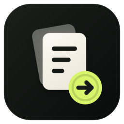
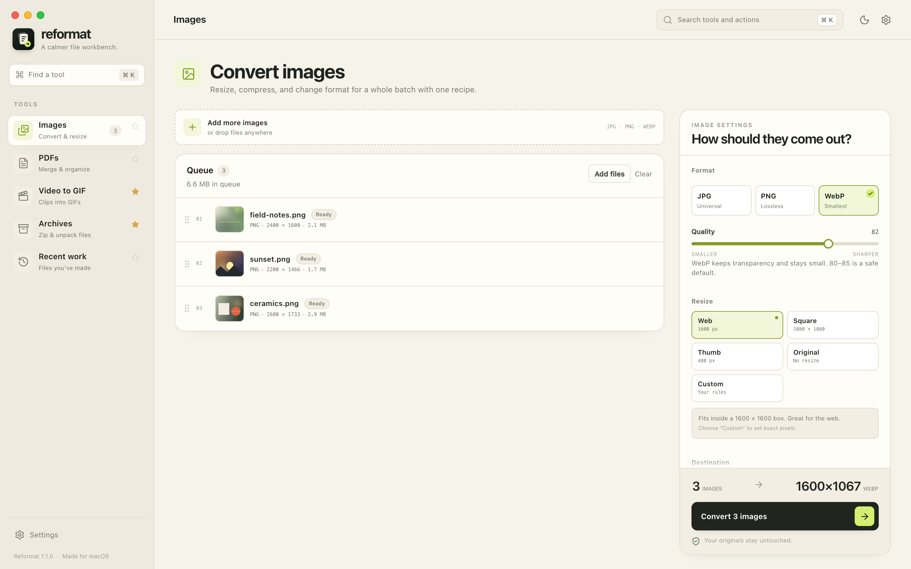
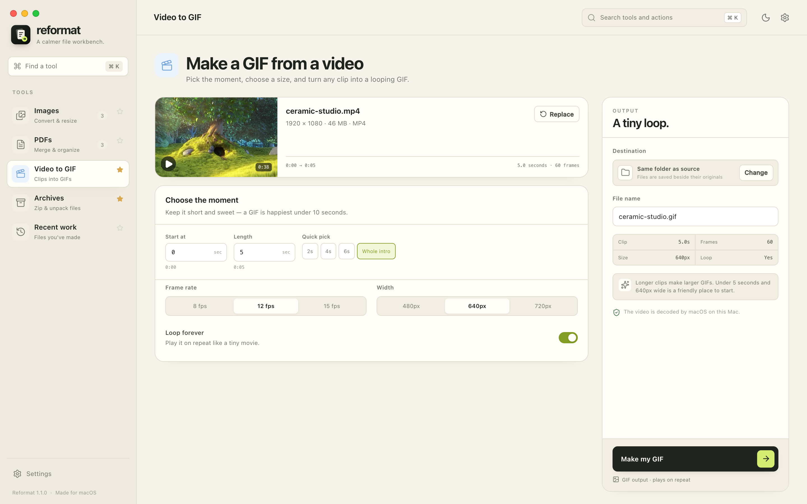
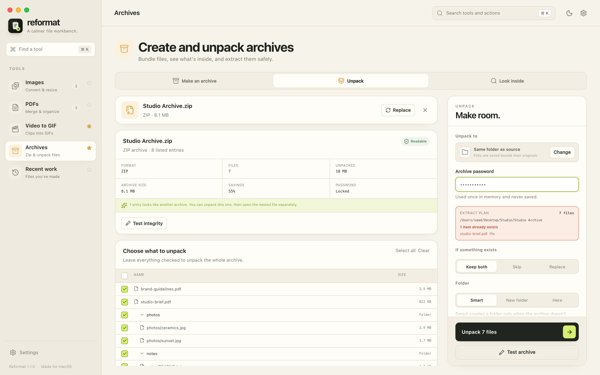
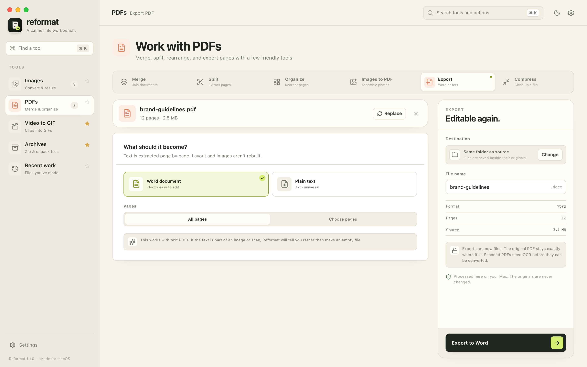
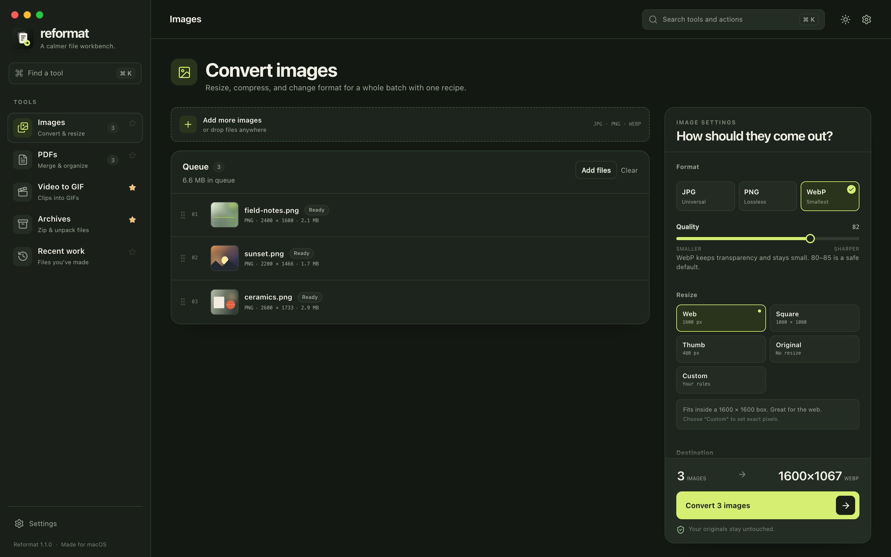
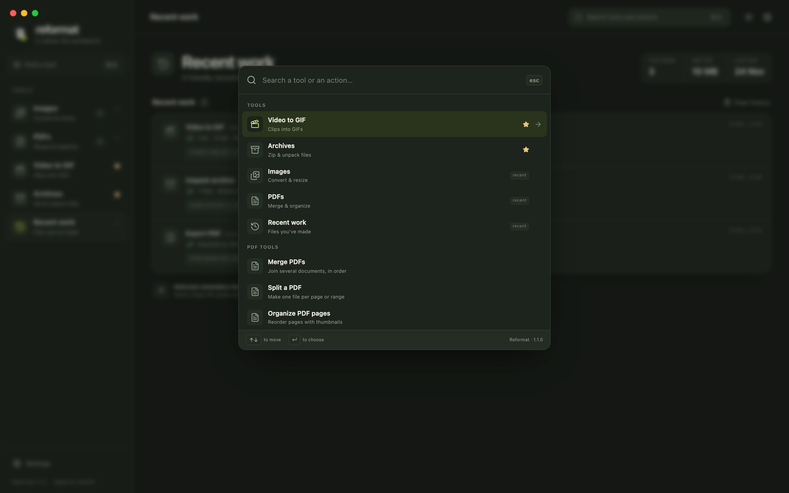

<div align="center">
  
  <h1>Reformat</h1>
  <p><strong>A friendly file workbench for macOS.</strong><br />
  Convert images, work with PDFs, make GIFs from video, and unpack archives — without sending your files anywhere.</p>

  <p>
    
    
    
    
    
  </p>

  <p>
    <a href="release/Reformat_1.1.0_aarch64.dmg"><strong>Download for macOS (Apple Silicon)</strong></a>
    &nbsp;·&nbsp;
    <a href="release/Reformat-1.1.0-macos-arm64.zip">ZIP archive</a>
    &nbsp;·&nbsp;
    <a href="release/INSTALL.txt">Install notes</a>
  </p>

  
</div>

---

Reformat is a native-feeling desktop app for the small file jobs that show up every day: a folder of photos for the web, a stack of PDFs to merge, a moment from a video that should become a GIF, a project folder that needs to be zipped. It keeps those jobs on your Mac, keeps your originals untouched, and keeps the interface calm enough to use without a manual.

No account. No upload. No telemetry. Read the [privacy notes](PRIVACY.md).

## What's new in 1.1

- **Video → GIF** — trim a moment from MP4, MOV or M4V using Apple's AVFoundation engine. No FFmpeg, no upload.
- **Archives** — create ZIP, 7Z, TAR, TAR.GZ, TAR.BZ2, TAR.XZ, GZIP, BZIP2 and XZ archives. Inspect, test and unpack ZIP, 7Z, TAR family, GZIP, BZIP2, XZ and RAR.
- **PDF export** — turn selectable PDF text into a `.docx` or `.txt` file, for all pages or a page range.
- **A friendlier interface** — warmer light theme, a real dark theme, simpler labels, fewer decorative stamps.
- **Command palette** — press `⌘K` to search tools, PDF actions and recent output files.
- **Pinned tools, recent tools and compact density** — make the app fit the way you work.
- **Archive safety** — staged extraction, path traversal and symlink protection, conflict policies, and adjustable size/file limits.

## A look around

<table>
<tr>
<td width="50%"></td>
<td width="50%"></td>
</tr>
<tr>
<td width="50%"></td>
<td width="50%"></td>
</tr>
</table>

<p align="center">
  
  
</p>

## What it does

| Tool | What you can do |
| --- | --- |
| **Images** | Convert JPG, PNG and WebP in batches; resize with Web/Square/Thumbnail presets or exact custom dimensions; fit, fill-crop or stretch; control quality; keep EXIF orientation; reorder before converting; use filename tokens such as `{name}-{width}w` |
| **PDF Studio** | Merge in reading order, split every page or named ranges, reorder real page thumbnails, assemble images into a PDF, compress losslessly, and export text to Word or plain text |
| **Video → GIF** | Pick a start and length, choose 8/12/15 fps and 480/640/720 px width, loop forever or play once; preview the result inline |
| **Archives** | Create nine formats; inspect entries before unpacking; selectively extract files or folders; test integrity; choose rename/skip/replace conflict behavior; use smart folder detection; protect ZIP/7Z with passwords; set your own safety limits |
| **Recent work** | A local history of outputs and skipped files, with one-click **Show in Finder** and a palette search over recent outputs |
| **Everyday flow** | Drag files anywhere, `⌘O` to open the current tool's picker, `⌘K` for the palette, cancel safely, reveal results in Finder, switch light/dark mode, and choose comfortable or compact spacing |

### Formats

| Area | Read | Write |
| --- | --- | --- |
| Images | JPG, PNG, WebP | JPG, PNG, WebP |
| Documents | PDF | PDF, DOCX (text export), TXT |
| Video | MP4, MOV, M4V | GIF |
| Archives | ZIP, 7Z, TAR, TAR.GZ, TAR.BZ2, TAR.XZ, GZIP, BZIP2, XZ, RAR | ZIP, 7Z, TAR, TAR.GZ, TAR.BZ2, TAR.XZ, GZIP, BZIP2, XZ |

RAR is extraction-only. Encrypted RAR archives are not supported; use the original RAR tool for those. 7Z creation uses LZMA2 with a balanced setting; the compression-level control is intentionally hidden because the writer does not expose a meaningful level for 7Z.

## Install

### Prebuilt macOS app

1. Download `Reformat_1.1.0_aarch64.dmg` from this repository's **Releases** page or from [`release/`](release/).
2. Open the DMG and drag **Reformat** into **Applications**.
3. On first launch, Control-click the app and choose **Open**.

The build is **ad-hoc signed but not notarized** — there is no Apple Developer certificate attached. If macOS still refuses to open it after Control-click → Open, clear the download quarantine flag:

```bash
xattr -dr com.apple.quarantine /Applications/Reformat.app
```

The prebuilt DMG targets **Apple Silicon**. See [Build from source](#build-from-source) to build on another Mac.

### Build from source

Prerequisites:

- macOS 11 or newer
- Xcode command-line tools with Swift (`xcode-select --install`)
- Node.js 20.19 or newer
- A current stable Rust toolchain

```bash
npm install
npm run app:dev       # builds the Swift video helper, then launches Tauri
npm run app:build     # builds the helper, .app and .dmg
```

`npm run app:build` writes the app and DMG to `src-tauri/target/release/bundle/`. The native video helper is built by [`scripts/build-video-helper.sh`](scripts/build-video-helper.sh); the Tauri bundle expects the target-triple-named sidecar in `src-tauri/binaries/`.

If you only want the browser UI during development:

```bash
npm run dev
```

File actions are disabled in a plain browser because there is no Tauri IPC bridge; the app is designed to run inside Tauri.

## Using Reformat

- **Drop anywhere.** Images go to the image converter, PDFs to PDF Studio, video to the GIF tool, and archives to the archive tool. Inside a tool, a drop goes to that tool.
- **Command palette.** `⌘K` searches tools, each PDF mode, theme/settings actions and recent files. Arrow keys move; Enter runs.
- **Open.** `⌘O` opens the picker for the current tool. Every output has a **Show in Finder** action.
- **Images.** Pick a format and quality, then a resize preset (or Custom). The preview name updates as you edit the template. Conversion writes new files and never replaces the originals.
- **PDFs.** Merge uses the queue order; drag the grip to reorder. Organize renders page thumbnails locally and saves a rebuilt copy. Export works on selectable text only.
- **Video → GIF.** Use the quick picks or exact start/length fields. A GIF is written to a temporary file and only appears in the destination after it is complete.
- **Archives.** In **Unpack**, the extraction plan checks the destination before you commit. Choose **Keep both**, **Skip** or **Replace**; the default is **Keep both**. Password fields stay in memory and are not persisted.
- **Cancel.** Long jobs can be cancelled from the top bar or the inspector. Cancelling before a write leaves no partial image, PDF, GIF or archive. Once archive staging has passed validation, the final same-volume rename commit is allowed to finish so the resulting folder always has a coherent outcome.

## Safety by design

Reformat is deliberately conservative.

- **Local-only.** No telemetry, accounts, cloud sync, remote fonts, analytics or update pings. The webview CSP blocks remote scripts, styles, fonts and connections.
- **Originals stay untouched.** Every operation writes a new file into the chosen destination. Image/PDF/GIF outputs use temporary files and a final rename. Same-name outputs are suffixed rather than silently overwritten.
- **Archives are staged.** Extraction writes into a private temporary directory first. Paths are validated, symlinks are rejected or skipped, archive entries are counted and size-limited, and only then are files moved into place.
- **Traversal and link protection.** Absolute paths, `..`, NULs and paths that would pass through an existing destination symlink are rejected. A file that collides with a symlink only removes the link, never its target.
- **Bombs are bounded.** The default extraction ceiling is 4 GB unpacked / 100,000 files, adjustable under **Safety limits**. ZIP, TAR, 7Z and single-stream extractors enforce limits while writing; RAR extraction is monitored while `bsdtar` runs and killed if it crosses the limit.
- **No shell interpolation.** Archive helpers are invoked with argument arrays, fixed executable paths, a controlled locale, hard timeouts and cancellation. RAR is read through macOS's own `/usr/bin/bsdtar`.
- **Atomic archive creation.** Archives are created in a hidden temporary file and published only after the writer finishes and syncs.
- **Corrupt files are isolated.** A damaged image or PDF gets a normal error row; the rest of the batch continues.

### Safety limits

| Limit | Default |
| --- | --- |
| Images | 80 MP, 512 MB, 32,000 px per side |
| PDFs | 512 MB, 5,000 pages |
| Video | 8 GB |
| GIF | 30 seconds, 300 frames, 1280 px maximum side (UI offers up to 720 px) |
| Archive file | 32 GB |
| Archive extraction | 4 GB unpacked · 100,000 files |
| Archive creation | 64 GB, 20,000 files |

The extraction limits can be changed in the Unpack inspector. Raise them only for archives you trust.

## Honest limitations

These are not hidden behind dead controls; they are simply not in this release.

- macOS only. The prebuilt binary is Apple Silicon; source builds use the host architecture.
- Ad-hoc signed, not notarized, and no auto-updater.
- RAR creation, encrypted RAR, multi-volume/split archives, archive conversion, add-to-existing, and removing/renaming entries inside an archive are unsupported.
- Archive creation is one archive at a time; extraction is one archive at a time. Pause/resume is not implemented; cancel is.
- Queues and job state are not persisted across app restarts. Recent work and preferences are stored locally.
- PDF export extracts text only; layout, columns, images and styling are not reconstructed. Scanned PDFs need OCR, which is not included.
- PDF compression is lossless and will not fake savings by degrading image quality.
- Image input is JPG, PNG and WebP. HEIC and AVIF are not supported.
- Video → GIF is macOS-only through AVFoundation; audio is not included in GIFs.
- The GIF helper caps output at 300 frames. Very large GIFs may be too big for the inline preview; use **Show in Finder**.
- No Finder extension, Services menu entry or “Open With” handler yet.
- 7Z creation does not expose a compression-level control; ZIP/TAR/GZIP/BZIP2/XZ do.
- Recent files in the palette are recent *outputs* from the local activity ledger, not a general filesystem index.
- The interface supports light/dark and comfortable/compact spacing, but not arbitrary accent colors, resizable panels or a list/grid toggle.

## Architecture

```text
src/                          React 19 + TypeScript
  components/                 Workspaces, PDF panels, palette, settings
  store/workbench.tsx         Queues, jobs, activity, toasts, preferences
  lib/api.ts                  Typed Tauri bridge
  lib/pdfPreview.ts           Local PDF.js page thumbnails
  styles.css                  Light/dark design system
src-tauri/src/
  lib.rs                      Tauri commands and job wiring
  job.rs                      Job registry, cancel tokens, progress events
  media.rs                    Image decode/resize/encode and probing
  pdf.rs                      Merge, split, reorder, compress, images→PDF, export
  video.rs                    AVFoundation helper orchestration
  archive.rs                  Create/inspect/test/extract, safety model
  files.rs                    Safe names, templates, collisions, atomic paths
src-tauri/binaries/           Built Swift sidecar (video helper)
scripts/                      Icon generation, helper build, test-video generator
src-tauri/tests/fixtures/     synthetic video and libarchive RAR fixtures
```

**Job flow.** The UI generates a job ID and calls a Tauri command. Rust registers an `Arc<AtomicBool>` cancel token, runs the blocking work off the UI thread, and emits `job-progress` events. The frontend listens globally, updates the top bar and the active workspace, and cancels through a second command. Outcomes carry per-file errors so a bad file never hides the rest of a batch.

**Native video.** The Swift helper uses `AVAssetImageGenerator` to probe a clip and write GIF frames with ImageIO. Rust parses `PROGRESS` lines, enforces a frame/width/duration budget, kills the helper on cancel, and publishes the finished GIF atomically.

**Archive safety model.** Each extractor writes to a staging directory owned by the job. Paths are normalized, rejected if absolute or containing `..`, and checked again before merge. The merge step creates parent directories without following destination symlinks and only replaces empty directories or links when the user explicitly chooses Replace. See the tests for the attack cases.

## Development

```bash
npm install
npm run dev                 # Vite UI preview (no Tauri IPC)
npm run app:dev             # full desktop app
npm run build               # type-check + production UI build
npm test                    # Rust test suite
npm run lint:rust           # cargo clippy --all-targets -- -D warnings
npm run fmt:rust            # cargo fmt
```

Verification used for this release:

```bash
npm test
cargo fmt --manifest-path src-tauri/Cargo.toml -- --check
cargo clippy --manifest-path src-tauri/Cargo.toml --all-targets -- -D warnings
npm run build
npm run app:build
```

The Rust suite currently has **43 tests**. They cover:

- image conversion, resize dimensions, corrupt inputs, oversized files and dimensions, safe filenames, and cancellation
- PDF merge/split/reorder/compress, embedded resources, range parsing, corrupt/oversized files, images→PDF, PDF→TXT/DOCX, page-range export, and cancellation
- video probing and a real AVFoundation GIF round-trip
- archive creation/extraction round-trips for ZIP, TAR.GZ, 7Z, GZIP, BZIP2, XZ, and RAR inspection/extraction
- password ZIP/7Z, selective extraction, duplicate source names, single-stream rejection, conflict policies, bomb limits, corrupted archives and integrity tests
- path traversal rejection, destination symlink attacks, symlink replacement, non-empty directory conflicts, and archive cancellation paths

The visual documentation was captured from the real React UI through a mocked Tauri IPC bridge with synthetic sample data. The backend paths are exercised separately by the Rust suite and by launching the packaged app.

## Release

Push a tag such as `v1.1.0`. The workflow in [`.github/workflows/release.yml`](.github/workflows/release.yml) builds an Apple Silicon DMG, writes a SHA-256 checksum, and attaches the DMG to the GitHub Release. Optional Developer ID signing and notarization secrets are read from the repository if present.

## Roadmap

- OCR for scanned PDFs
- Split/multi-volume archives and encrypted RAR
- Archive conversion and add/remove entries
- PDF page rotate/insert/delete
- HEIC/AVIF input
- Finder extension and “Open With”
- Notarized universal build and auto-update
- CLI mode

## License

MIT — see [LICENSE](LICENSE). Third-party acknowledgements are in [THIRD_PARTY_NOTICES.md](THIRD_PARTY_NOTICES.md).
