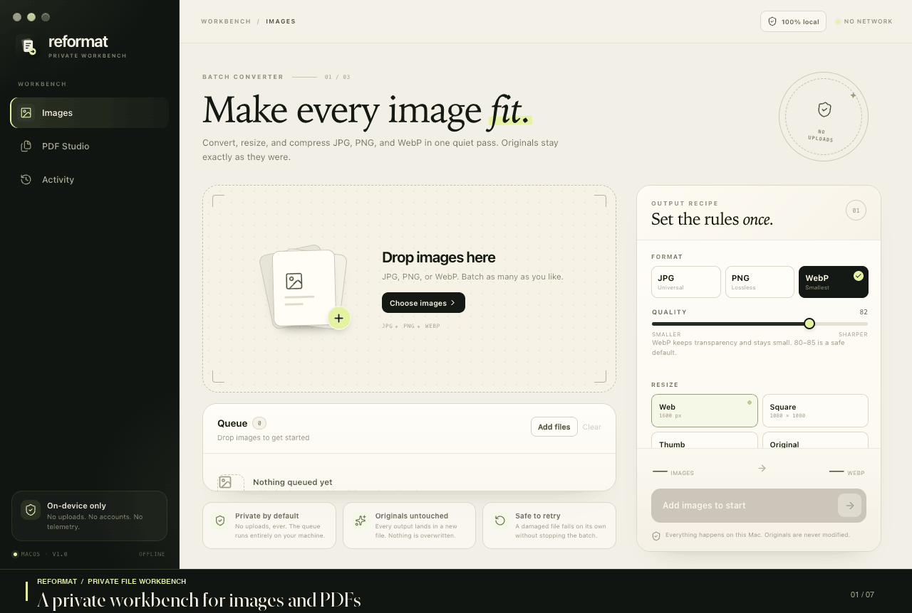
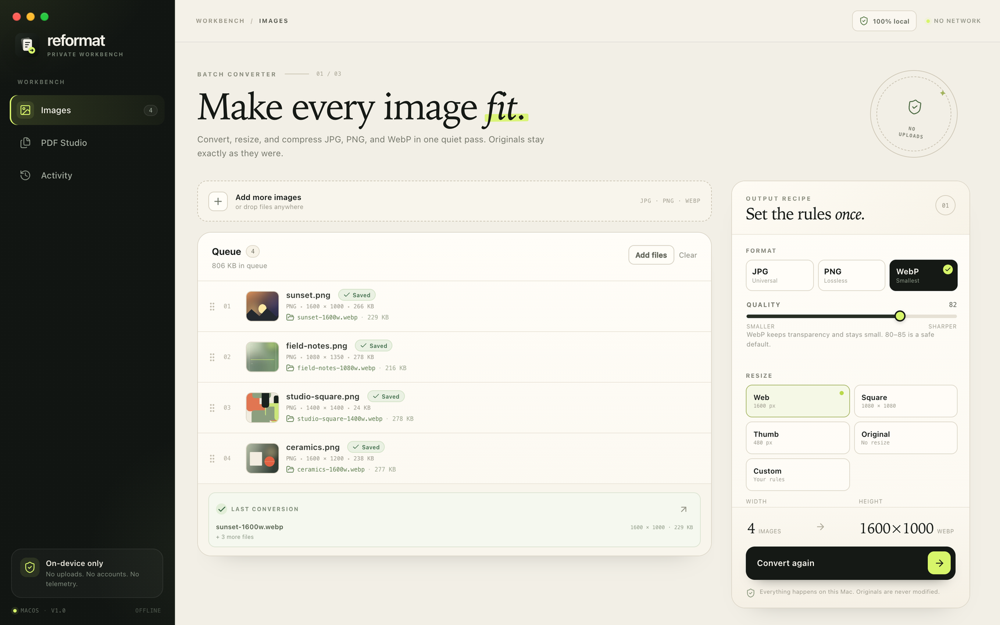
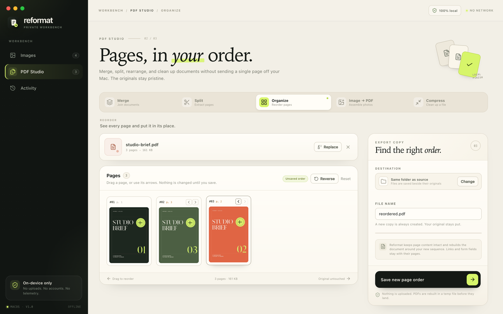
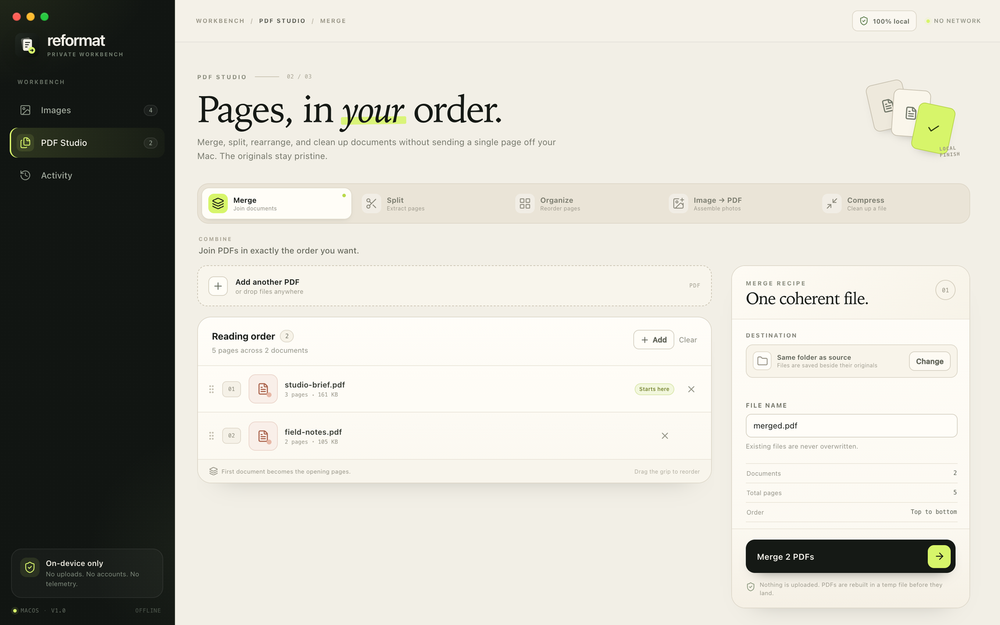
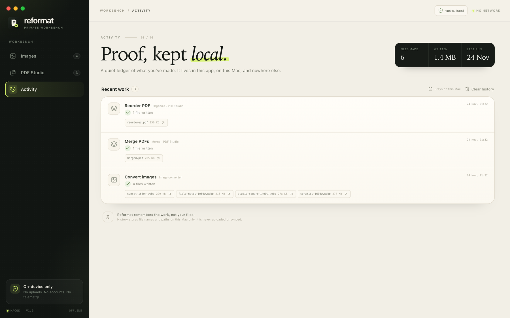

<div align="center">
  
  <h1>Reformat</h1>
  <p><strong>A private document &amp; media workbench for macOS.</strong><br />
  Batch-convert images, merge, split and organize PDFs — entirely on your Mac.</p>

  <p>
    
    
    
    
    
  </p>

  <p>
    <a href="release/Reformat_1.0.0_aarch64.dmg"><strong>Download for macOS (Apple Silicon)</strong></a>
    &nbsp;·&nbsp;
    <a href="release/Reformat-1.0.0-macos-arm64.zip">ZIP archive</a>
    &nbsp;·&nbsp;
    <a href="release/INSTALL.txt">Install notes</a>
  </p>

  
</div>

---

**Reformat** is a native-feeling desktop utility for the files you'd rather not hand to a website. Drop in a folder of photos, merge a stack of PDFs, or rebuild a document in a new page order. Every byte is processed locally, every original is left alone, and every output is written atomically.

No account. No upload. No telemetry.

## Why it exists

Most "free online converters" ask you to upload private documents to a server you don't control. Reformat takes the opposite position: the computer you already own is the fastest, most private conversion machine you have. The app makes no network requests and allows no remote content in its webview.

The workflow is deliberately quiet: drag files in, choose a recipe, watch progress, cancel if you change your mind, and find the result in Finder.

## What it does

| Tool | Capabilities |
| --- | --- |
| **Image converter** | JPG, PNG and WebP inputs · batch conversion · Web/ Square/Thumbnail presets · custom fit, fill-and-crop, or stretch · quality control · EXIF orientation · optional upscaling · filename templates · drag-to-reorder queue |
| **PDF Studio — Merge** | Add any number of PDFs, drag them into reading order, merge into one document with every page, font, link and annotation kept |
| **PDF Studio — Split** | Split every page into its own file, or extract named ranges (`1-3, 5, 8-`) into separate documents |
| **PDF Studio — Organize** | Real page thumbnails rendered locally; drag or arrow-key reorder; reverse; save a rebuilt copy without touching the original |
| **Image → PDF** | One image per page · A4, Letter, or fit-to-image · margin presets · high-quality JPEG embedding · white flattening for transparency |
| **Clean & compress** | Lossless structural rebuild, unused object removal, stream compression, optional metadata stripping |
| **Job control** | Live progress events, safe cancellation between files, per-file error isolation, collision-safe output names, atomic writes |
| **Activity** | Local ledger of outputs and skipped files, with one-click **Show in Finder** |

<table>
<tr>
<td width="50%"></td>
<td width="50%"></td>
</tr>
<tr>
<td width="50%"></td>
<td width="50%"></td>
</tr>
</table>

## Install

### Prebuilt macOS app

1. Download `Reformat_1.0.0_aarch64.dmg` from this repository's **Releases** page (or use the local build in [`release/`](release/) while working from source).
2. Open the DMG and drag **Reformat** into **Applications**.
3. On first launch, Control-click the app and choose **Open**.

The build is **ad-hoc signed but not notarized** — there is no Apple Developer certificate attached. If macOS still refuses to open it after Control-click → Open, clear the download quarantine flag:

```bash
xattr -dr com.apple.quarantine /Applications/Reformat.app
```

The provided DMG targets **Apple Silicon**. The release workflow builds a universal binary when run from a tagged release.

### From source

```bash
# Prerequisites: macOS with Xcode command-line tools, Node.js 20.19+, Rust stable
npm install
npm run tauri dev        # live development app
npm run tauri build      # .app + .dmg under src-tauri/target/release/bundle
```

The Tauri app is built with Rust commands and a React/TypeScript frontend. PDF thumbnails are rendered in the webview with PDF.js; the file work itself happens in Rust.

## Using Reformat

- **⌘O** opens a file picker for the active tool. Drop files anywhere in the window to route them automatically.
- **Images:** choose a format, a resize preset and a template such as `{name}-{width}w`, then press **Convert**. Reformat never overwrites an existing file; collisions get `-2`, `-3`, and so on.
- **Merge:** documents are merged in queue order. Drag the grip to change the order.
- **Organize:** page thumbnails are rendered from the selected PDF. Drag a page, use its arrow buttons, or **Reverse** the deck. Save writes a fresh copy with the same page content in the new order.
- **Split:** `every page` creates one PDF per page; `custom ranges` accepts comma-separated groups such as `1-3, 5, 8-`.
- **Cancel:** cancellation is cooperative and checked between files and immediately before any write. Completed files stay; unfinished files write nothing.
- **Errors:** a corrupt image or PDF is shown with its error in the queue and skipped, never crashing the batch.

## Safety by design

- **No network.** No telemetry, remote fonts, analytics, update checks, accounts or cloud sync.
- **Originals are never modified.** Every operation writes a new file into the destination folder. Same-name outputs are suffixed rather than replaced.
- **Atomic writes.** Each result is encoded into a temp file in the destination folder and only renamed into place after success. Cancel or failure leaves no partial output.
- **Per-file isolation.** A damaged file produces a normal error item; the rest of the queue keeps going.
- **Bounded work.** Reformat rejects oversized inputs before decoding and has explicit page/queue limits.
- **Tauri security.** The frontend is local-only and the webview CSP blocks remote scripts, styles, fonts and connections. File paths come only from native dialogs or drag-and-drop.

Read the full [privacy notes](PRIVACY.md).

### Explicit limits

| Limit | Value |
| --- | --- |
| Image size | 80 MP, 512 MB, 32,000 px per side |
| PDF size | 512 MB, 5,000 pages |
| PDF preview for Organize | 96 MB |
| Images per image → PDF | 500 |
| Split outputs per job | 2,000 |

Password-protected PDFs, HEIC input, and image downsampling for scanned PDFs are not supported in v1. PDF compression is **lossless** and will not pretend to shrink image-heavy scans by lowering their quality.

## Architecture

```text
src/                         React 19 + TypeScript UI
  components/                Screens, queues, inspector, PDF panels
  store/workbench.tsx        Queue state, job lifecycle, activity, toasts
  lib/api.ts                 Typed Tauri bridge
  lib/pdfPreview.ts          Local PDF.js thumbnail renderer
src-tauri/src/
  lib.rs                     Tauri commands + job wiring
  job.rs                     Job registry, cancel tokens, progress events
  media.rs                   image/image-webp decode, resize, encode, probe
  pdf.rs                     lopdf merge/split/reorder/compress/image-to-PDF
  files.rs                   Safe filenames, templates, collision handling
src-tauri/capabilities/      Minimal Tauri permissions (dialog open only)
```

**Job flow:** the UI generates a job ID and invokes a command. The Rust side registers an `Arc<AtomicBool>` cancellation token, runs the blocking work on `spawn_blocking`, and emits `job-progress` events. The frontend listens globally and cancels via a second command. Results include per-file success/error data so the UI can update each row.

**Error handling:** every long-running command runs inside `catch_unwind`; individual files are processed independently. Image headers are inspected before decode, and both display dimensions and decoded memory are bounded.

**No network dependency:** the only Rust dependencies involved in file work are `image`, `webp` and `lopdf`; the UI bundles PDF.js and system fonts. `docs/` assets are repository documentation only.

## Development

```bash
npm install
npm run dev                 # browser UI preview (no file bridge)
npm run tauri dev           # full desktop app with devtools
npm run build               # type-check + production frontend
npm test                    # Rust unit tests
npm run tauri build         # bundled .app and .dmg
```

### Tests and verification

```bash
npm test
cargo fmt --manifest-path src-tauri/Cargo.toml -- --check
cargo clippy --manifest-path src-tauri/Cargo.toml --all-targets -- -D warnings
npm run build
```

The 17 Rust tests cover:

- valid image conversion and resize dimensions
- corrupt image and corrupt PDF handling
- an oversized sparse image rejected before decode
- an oversized sparse PDF rejected before parsing
- oversized image dimensions rejected before decode
- collision-safe output filenames
- pre-canceled image and PDF jobs writing nothing
- PDF merge page preservation
- split every-page output validity
- page range parsing and validation
- visual page-order changes after reorder
- lossless compression keeping the document readable
- images-to-PDF page creation with corrupt inputs skipped
- embedded image resources surviving merge and split

The UI screenshots and demo GIF are captured from the real React UI using a mocked Tauri IPC bridge for sample data. The backend paths above are exercised separately by Rust tests and the packaged app.

### Demo assets

The demo uses generated sample images and PDFs in `docs/` only; no sample files are shipped inside the app. Screenshots are rendered at 2× on macOS Chrome and downscaled for the README.

## Release

Push a tag such as `v1.0.0`. The workflow in [`.github/workflows/release.yml`](.github/workflows/release.yml) builds a universal macOS DMG, creates a SHA-256 checksum, and attaches both to the GitHub Release. Optional Developer ID signing/notarization secrets are documented in the workflow.

## Roadmap

- PDF → image export
- OCR via Tesseract for scanned documents
- Headless CLI mode
- Signed and notarized universal build / auto-update
- More page operations: rotate, insert, delete

## License

MIT — see [LICENSE](LICENSE).
